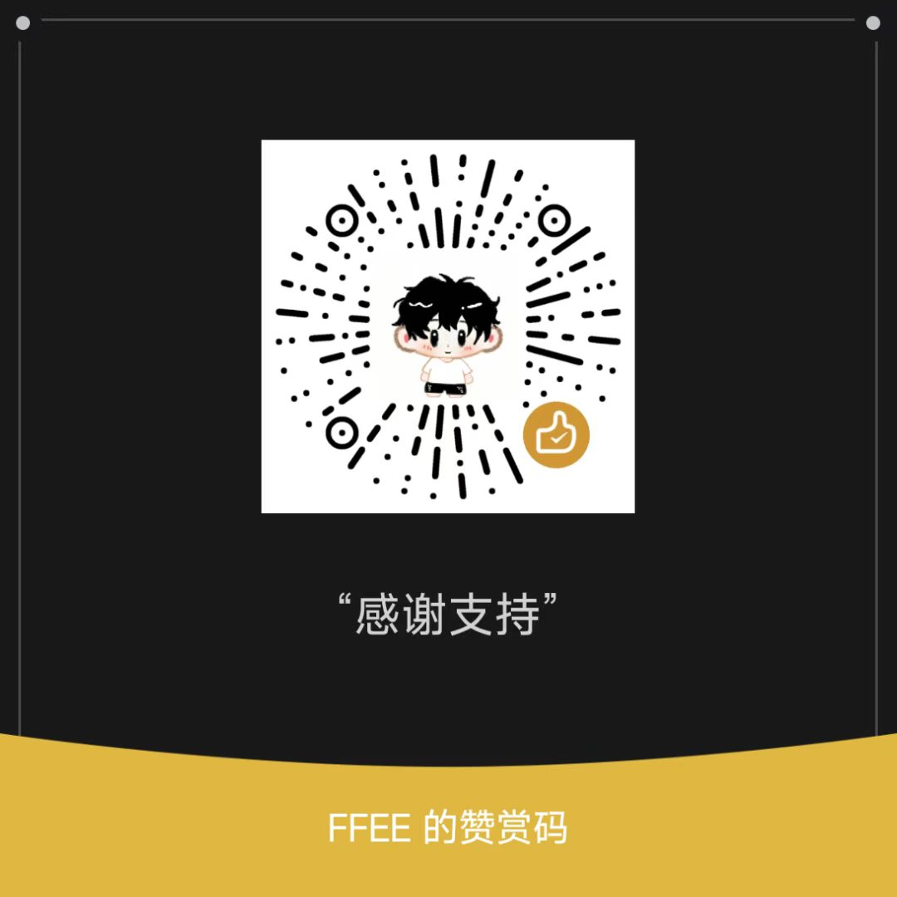

<p align="center">
  
</p>

<h1 align="center">Lamp Guide 网关镜像</h1>
<p align="center"><strong>把 Lamp Guide 的网关装进容器：无界面、多架构、一条命令起跑。</strong></p>
<p align="center">上游 <a href="https://github.com/LAGcomcom/Lamp-Guide">LAGcomcom/Lamp-Guide</a> 的容器化分支 · Go + 无界面入口 + Docker</p>
<p align="center">
  <a href="https://github.com/3322786756/lamp-guide-docker/pkgs/container/lamp-guide-docker">容器镜像</a> ·
  <a href="docs/DOCKER.md">Docker 使用说明</a> ·
  <a href="https://github.com/LAGcomcom/Lamp-Guide">上游桌面版</a> ·
  <a href="https://github.com/LAGcomcom/Lamp-Guide-Android">安卓原生版</a>
</p>

Lamp Guide 原本是 Windows 桌面应用：界面用 Win32 + WebView2，网关和界面跑在同一个进程里。本仓库在它基础上补了一层**无界面入口**，让网关单独跑在 Linux 容器里——NAS、VPS、旁路由、树莓派都能当模型网关用，客户端填 `http://<主机>:8787/v1` 就能按 OpenAI / Anthropic 协议调用。

容器里没有窗口、托盘和 WebView2，所以镜像很小；反过来，桌面版专有的功能（Agent 配置注入、应用自更新、sing-box 订阅应用）在容器里不生效，取舍和替代做法见 [docs/DOCKER.md](docs/DOCKER.md)。

## 快速开始

```bash
docker run -d --name lamp-guide \
  -p 8787:8787 -v lamp-guide-data:/data \
  -e ZEN_GATE_KEY=换成你自己的长随机串 \
  ghcr.io/3322786756/lamp-guide-docker:latest

docker logs lamp-guide          # 启动日志里有 API 地址和主密钥提示
curl http://127.0.0.1:8787/health
```

也可以用仓库里的 `docker-compose.yml`：`docker compose up -d`。

Unraid 用户有现成模板：[`unraid/lamp-guide.xml`](unraid/lamp-guide.xml)，下载到用户模板目录或在 Docker 页粘贴模板地址即可，细节见 [docs/DOCKER.md](docs/DOCKER.md)。

`/data` 是网关的全部状态（`config.json`：渠道登录、供应商、主密钥、用量统计），**卷不挂，重建即清零**。

## 支持哪些架构

一次构建出三份，`docker pull` 会按宿主机架构自动挑，不用加 `--platform`：

| 平台 | 典型设备 |
| --- | --- |
| `linux/amd64` | x86 服务器、NAS、普通 PC |
| `linux/arm64` | 树莓派 4/5、ARM 云主机、Apple Silicon |
| `linux/arm/v7` | 树莓派 2/3、老 ARM 盒子 |

构建阶段跑在构建机原生架构上，靠 Go 交叉编译出目标架构二进制，不需要 QEMU 模拟编译器。

## 和上游的差别

| 改动 | 说明 |
| --- | --- |
| `cmd/lamp-guide-server` | 无界面入口：读环境变量、打印地址与密钥、收到 SIGTERM 干净退出 |
| `Dockerfile` / `docker-compose.yml` / `.dockerignore` | 多阶段构建、静态二进制、非 root 用户、HEALTHCHECK、多架构 |
| 远端管理开关 | 管理接口仍默认只认回环；`ZEN_GATE_ALLOW_REMOTE_ADMIN=1` 时远端请求改用主密钥校验 |
| `ZEN_GATE_KEY` | 启动时用自己的主密钥覆盖 `config.json` 里的随机密钥，省去从日志里翻 |
| CI | 在 GitHub Actions 里真机构建镜像、起容器冒烟，再推 GHCR 多架构清单 |

## 环境变量

| 变量 | 默认值 | 作用 |
| --- | --- | --- |
| `ZEN_GATE_KEY` | 空 | 自定义主密钥；设了就写进 `config.json`，之后启动一直沿用 |
| `ZEN_GATE_HOME` | `/data` | 数据目录，必须指向挂卷的位置 |
| `ZEN_GATE_PORT` | `8787` | 监听端口 |
| `ZEN_GATE_ALLOW_LAN` | `1` | 监听 `0.0.0.0`，允许局域网访问 |
| `ZEN_GATE_ALLOW_REMOTE_ADMIN` | `0` | 允许远端用主密钥调 `/admin/api/*` |
| `ZEN_GATE_SHOW_KEY` | `0` | 启动日志里打印完整主密钥 |
| `TZ` | `Asia/Shanghai` | 容器时区 |

把桌面应用里已登录的渠道搬进容器、管理接口的调用示例、反向代理与证书、常见问题，都在 [docs/DOCKER.md](docs/DOCKER.md)。

---

## 以下是上游 Lamp Guide 桌面版说明

## 有什么变化

| 功能 | 使用方式 |
| --- | --- |
| 完整桌面界面 | 服务、模型、聚合、渠道、供应商、OpenCode、联网、Agent、日志、设置，集中在侧栏 |
| 模型聚合 | 搜索模型名称、ID 或渠道，启用项优先显示，分页按钮位于列表底部 |
| 渠道参与开关 | 点击“参与轮换 / 不参与轮换”切换接入状态，自定义渠道也可管理 |
| 按模型批量控制 | 展开模型后“全部启用 / 全部停用”，统一控制该模型下的渠道候选 |
| 完整模型目录 | 纳入上游返回的免费与积分模型，展开渠道查看其积分倍率；未知价格不编造 |
| 模型名称归并 | 统一可确认的别名，保留版本、能力和变体差异，减少重复条目 |
| 禁用状态同步 | 模型所有候选被停用后，从聚合 API 与相关客户端同步名单中移除 |
| OpenCode 专页 | 单独管理相关设置、代理与额度刷新 |
| 账号与代理 | 管理渠道登录状态、额度、出口、代理模式与订阅轮换 |
| 自动与手动签到 | 渠道页「一键签到」、按账号定时领取、渠道开关、失败补签；能力与限制见[签到及渠道状态](docs/CHECKIN_AND_CHANNELS.md) |
| 新渠道 | AStudio、AutoClaw 国内/国际版、超级麦吉/MagiCrew 国际版；支持插件导入或手工凭据，新渠道为试验接入，原生登录向导及真实账号验证尚待完成 |
| 日间 / 夜间 | 标题栏一键切换、平滑过渡、记忆主题，兼容系统减少动画偏好 |
| 安装与卸载 | 中文安装向导、目录与快捷方式选择，附 WebView2 离线运行环境 |

模型目录、额度、积分倍率及可用性以各渠道实际返回为准。目录列出模型，不代表当前账号一定具备调用权限；付费模型可能消耗积分或产生费用。

## 开始使用

1. 打开 [Releases](https://github.com/LAGcomcom/Lamp-Guide/releases/latest)，下载 `LampGuide-Setup-1.2.1-win-x64.exe`。后续版本使用对应版本号。
2. 正常退出正在运行的 zen-gate / Lamp Guide，再按安装向导完成安装。首次安装缺少 WebView2 时会补齐运行环境。
3. 在“服务”页查看实际 Base URL、端口与访问 Key；在“渠道”登录账号，或在“供应商”添加自己的 API。
4. 在“聚合”搜索和展开模型，选择渠道是否参与轮换，并查看各渠道的积分倍率。
5. 在“Agent”页配置支持的客户端，也可以将“服务”页的地址、Key 和模型 ID 填入兼容客户端。

安装包附带 SHA-256 校验文件。在 PowerShell 中运行以下命令，并与 `.sha256` 文件比较：

```powershell
Get-FileHash .\LampGuide-Setup-1.2.1-win-x64.exe -Algorithm SHA256
```

当前安装包未做代码签名。WebView2 使用微软签名的官方运行环境。更新 Lamp Guide 时，请下载新安装包并安装到原目录；目前不提供原地替换 EXE 的自动升级。

## 原有账号和配置

为兼容 zen-gate，继续使用原有数据路径与协议标识：

| 内容 | 默认位置 |
| --- | --- |
| 网关账号、配置、日志 | `%APPDATA%\zen-gate`，可用 `ZEN_GATE_HOME` 覆盖 |
| WebView2 与主题数据 | `%LOCALAPPDATA%\ZenUI\webview` |
| 应用安装目录 | `%LOCALAPPDATA%\Programs\Lamp Guide` |

迁移前备份网关数据目录。两个程序会共享账号与配置，避免同时运行，以免端口冲突或并发写入。卸载保留账号、配置、主题缓存和共享的 WebView2 环境。详细说明见 [迁移指南](docs/MIGRATION.md)。

## 源码与构建

需要 Windows x64、Go 1.26、Node.js 22+。前端使用原生 HTML / CSS / JavaScript，随 Go 二进制嵌入，无前端打包服务。

```powershell
git clone https://github.com/LAGcomcom/Lamp-Guide.git
cd Lamp-Guide
go test ./...
go vet ./...
go build -trimpath -ldflags="-H=windowsgui" -o LampGuide.exe .
```

上面的命令构建应用；带图标、版本资源及 WebView2 的完整安装包另见 [安装包构建说明](packaging/README.md)。Windows CI 会检查 Go 测试、静态分析、JavaScript 语法并构建应用。

### 在 Docker 里跑网关

界面是 Win32 + WebView2，只能跑在 Windows 上；容器里跑的是网关本身——`cmd/lamp-guide-server`，没有窗口、托盘和 WebView2。开箱用法、环境变量和迁移已有渠道的步骤见上面的[快速开始](#快速开始)与 [docs/DOCKER.md](docs/DOCKER.md)；从源码构建镜像用仓库里的 `Dockerfile`，多架构用 `docker buildx build --platform linux/amd64,linux/arm64,linux/arm/v7`。

| 目录 | 职责 |
| --- | --- |
| `main.go`、`identity_windows.go` | 进程入口与 Windows 应用身份 |
| `cmd/lamp-guide-server` | 无界面网关入口，容器镜像的启动命令 |
| `Dockerfile`、`docker-compose.yml` | 网关镜像与本地编排 |
| `unraid` | Unraid Docker 模板（`lamp-guide.xml`） |
| `internal/shell`、`internal/native` | Win32 窗口、WebView2 宿主与系统调用 |
| `internal/host`、`internal/zenbridge` | 页面宿主接口及进程内管理请求 |
| `internal/zen` | 网关、渠道、账号、模型聚合、路由及配置存储 |
| `web` | 桌面页面、主题样式与 SVG 图标 |
| `packaging`、`tools` | 安装向导、品牌资源及发布构建脚本 |

## 支持项目

如果 Lamp Guide 对你有帮助，欢迎自愿赞赏，支持后续开发与维护。

使用微信扫描下方赞赏码，感谢支持。

<p align="center">
  
</p>

## 来源与许可

本项目是 **[LAGcomcom/zen-gate](https://github.com/LAGcomcom/zen-gate) 的桌面重构与扩展**，保留原作者与上游许可声明。渠道协议实现参考了 [dsh-our-free-model](https://github.com/Ebony-Vinyl/dsh-our-free-model)；内嵌 QoderCN 网关来源于 [qodercn-gateway](https://github.com/Morpheus799/qodercn-gateway)。

渠道账号、额度与聚合实现还参考了 [iJetLi/dsh-providers-hub](https://github.com/iJetLi/dsh-providers-hub)。项目许可证见 [LICENSE](LICENSE)，各组件来源、独立许可及 QoderCN 上游权利范围说明见 [THIRD_PARTY.md](THIRD_PARTY.md)。第三方服务名称和商标属于其各自所有者，账号权限、额度和使用规则由对应服务决定。

参与开发见 [CONTRIBUTING.md](CONTRIBUTING.md)，安全反馈见 [SECURITY.md](SECURITY.md)，版本变化见 [CHANGELOG.md](CHANGELOG.md)。
